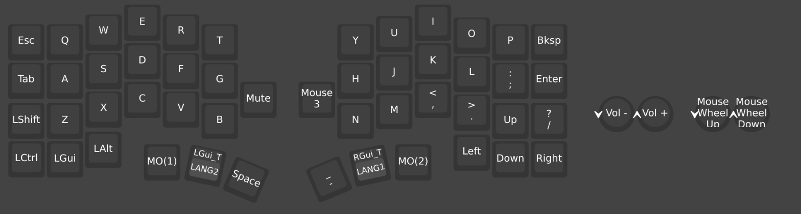
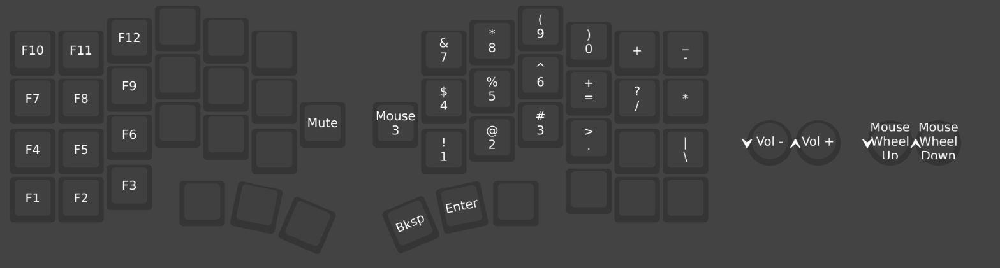
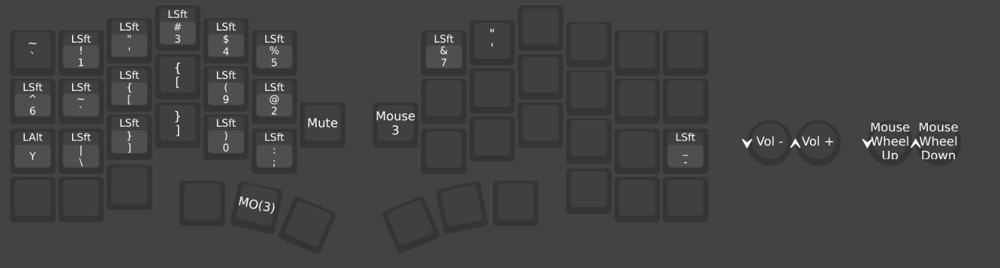
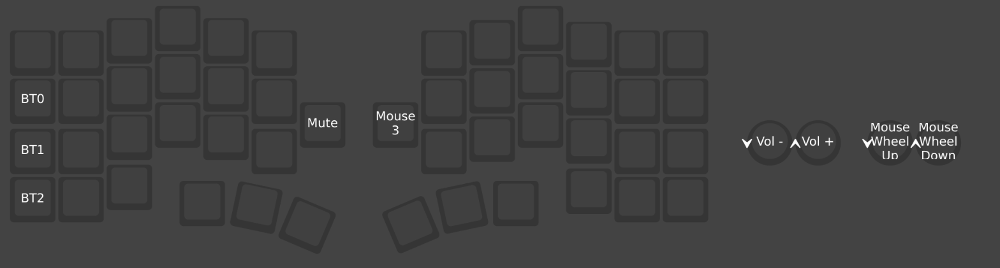

# cornix-vial

Cornix 用の [Vial](https://get.vial.today/) レイアウトファイルです。

| ファイル | 対象OS |
| --- | --- |
| `cornix_mac.vil` | macOS |
| `cornix_windows.vil` | Windows |

## 読み込み方

1. キーボードを接続して [Vial Web](https://vial.rocks/) またはVialアプリを開く
2. **File → Load saved layout...** で `.vil` ファイルを選ぶ

## Mac版とWindows版の違い

違うのはLayer 0の左下3キーだけです。

| 位置 | Mac | Windows |
| --- | --- | --- |
| 左下1 | Cmd | Ctrl |
| 左下2 | Option | Win |
| 左下3 | Ctrl | Alt |

## キー配置

Vialの画面をそのまま載せています。

- `LGui_T / LANG2` などは、タップで下段（英数・かな）、長押しで上段（GUI）として働くキーです。Macでは⌘、WindowsではWinキーになります。
- `MO(n)` は押している間だけLayer nに切り替わります。
- `Mute` と `Mouse 3` はエンコーダの押し込みです。

### Layer 0：ベース（Windows版）

### Layer 0：ベース（Mac版）

### Layer 1：ファンクション・テンキー（左親指 `MO(1)` 長押し）

### Layer 2：記号（右親指 `MO(2)` 長押し）

記号はOSのキーボード配列をUS配列にしている前提の割り当てです。`LAlt + Y` はMac（US配列）で `¥` を入力するためのキーです。

### Layer 3：Bluetooth（Layer 2中に左親指 `MO(3)`）

`BT0`〜`BT2` は接続先プロファイルの切り替えです。

Layer 4〜9は未使用です。マクロ・タップダンス・コンボの設定もありません。
